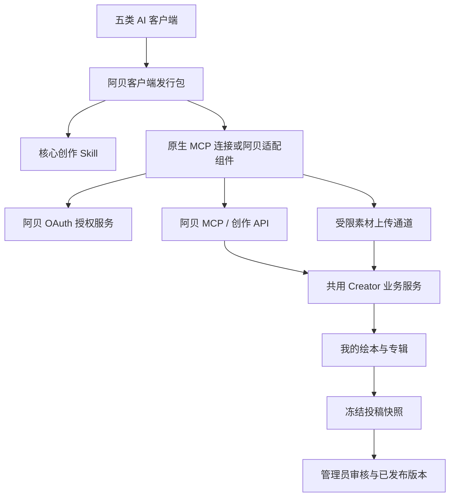

# 阿贝绘本创作助手：客户端首版方案

日期：2026-10-12。状态：方案基线，待开发与客户端实测；本文不代表功能已经上线。

## 产品与范围

产品名为「阿贝绘本创作助手」，对外类别为「AI 创作插件」。用户使用自己的 AI 客户端创作绘本和专辑，授权阿贝账号后保存、同步和投稿；管理员审核通过的确定版本在阿贝前台公开展示。

首版包含五类客户端。Claude 按客户端家族处理，Claude Code、Claude Desktop/Cowork 分别登记验收，不能用其中一个入口通过代替其余入口。

| 客户端 | 首选交付方式 | 上线前必须解决的适配项 |
| --- | --- | --- |
| Codex | Skill 与 MCP 配置组成的插件 | 安装、浏览器授权、本地素材上传、更新 |
| Claude 客户端 | Claude Code 插件；Desktop/Cowork 使用其支持的插件或连接器包装 | 各入口独立验证授权、运行环境和素材传输；远程连接不代表能读取用户电脑文件 |
| 豆包工作 PC 客户端 | 按开放平台规范打包 Skill、连接器及必要工具 | 具体版本的 OAuth 流程、上传能力、插件分发及入驻条件 |
| WorkBuddy | 优先采用 MCP + Skill 连接器 | OAuth 回调和客户端注册、文件传输；每个发行包遵守其 MCP/CLI 接入形态约束 |
| DeepSeek Harness | 注册 Skill 和阿贝工具的适配插件 | MCP 已有接入机制；浏览器授权、凭证刷新和安装更新需要专项适配 |

五类均为首版目标。每个发行包记录已验收的产品入口、版本、操作系统、授权方式和上传方式，未通过的组合不标为已支持。优先验证各产品正式支持的 macOS/Windows 版本，Harness 其他运行方式单独登记，不推定通用兼容。

首版包含：中文图文绘本、可选逐页配音、专辑封面与目录排序、草稿同步、修改同步、投稿、退回原因查询、审核通过后的链接返回、授权撤销。

首版不包含：普通网页版 AI 工具适配、浏览器扩展、网页素材导入入口、手机端适配、新建阿贝 AI 聊天工作台、付费模型代调用、支付与商业分成、多语言能力扩展、多人协同编辑。阿贝网站仍承载安装说明、登录授权、作品预览、账号管理和后台审核，这些页面属于客户端闭环。

## 用户流程

1. 在阿贝安装页选择客户端，安装对应的「阿贝绘本创作助手」发行包。
2. 点击或对话发起「连接阿贝账号」，在阿贝页面登录、确认账号和授权范围。
3. 用户提出单本或系列需求，助手检查客户端可用的文字、图像、语音与文件能力。
4. 按现有示范绘本制作规范完成文稿、分镜、样张、批量素材与验收；缺少某项生成能力时明确说明，使用用户已有素材或保留未完成草稿，不冒充生成成功。
5. 用户授权同步后，客户端上传实际素材并保存到「我的绘本／专辑」，返回登录后可访问的预览链接。可在用户已授权的任务范围内持续同步，无需逐页重复授权。
6. 用户明确要求投稿时，提交所选作品版本和专辑版本；仅要求同步时保持草稿。任务开始已包含投稿指令的，不再要求重复确认。
7. 管理员审核通过后公开，退回时客户端可查询理由并继续修订。助手只在获得服务端真实状态后报告「待审核」或「已发布」。

授权安装、账号连接、作品投稿是不同动作。安装不等于授予账号权限，账号授权不等于要求立即投稿。

## 共用架构

维护一套核心 Skill、一套版本化作品格式、一套服务端业务逻辑。客户端差异集中在安装配置、认证适配和素材传输，不复制五套绘本业务实现。

MCP 模块在现有 NestJS `apps/api-core` 中实现，以 Streamable HTTP 对外服务；创作 API 与 MCP 调用同一业务服务。FastAPI AI Gateway 不承担授权、作品存储或审核业务。

辅助组件只负责授权、受限文件读取、上传、版本检查及调用阿贝服务。运行时由安装包或客户端受支持机制提供，用户无需自行配置 Node/Python。组件只读取用户选定的项目目录或文件，不扫描整个电脑；沙箱路径在对应客户端内解析，不传给远程服务当作可读取路径。

支持原生远程 OAuth 的入口优先使用原生授权。需要适配的入口可使用本地 stdio MCP 组件或该平台允许的 CLI/插件组件连接同一阿贝服务。WorkBuddy 每个发行包选择平台支持的接入形态，不能假定任意混装 MCP 与 CLI 都受支持。

## 账号授权与权限

沿用阿贝现有用户登录，新增「客户端委托授权」。用户本次明确要求账号授权与审核投稿；设计仅覆盖这项能力，不扩展第三方社交登录或复杂权限矩阵。

- 原生远程连接采用 OAuth 授权码 + PKCE S256；提供资源与授权服务器元数据，校验回调地址、客户端身份、授权码、权限范围和令牌受众。客户端注册机制按实际客户端要求验证，不能只实现授权页。
- 阿贝辅助组件采用 OAuth Device Authorization Grant：打开阿贝授权页，显示并核对本次设备码、客户端名称和账号，用户确认后组件领取凭证。设备码短时、一次性、限速；轮询遵守间隔和过期规则，不让用户在对话里粘贴密码或长期 Token。
- 两种方式共用授权记录、scope 和撤销机制。设备流程用于我们自己的组件，不假定原生远程 MCP 客户端自动支持它。
- 权限固定为读取本人作品、编辑本人草稿、上传本人素材、维护本人专辑、提交和查询本人投稿。首版不授予后台审核、账号安全设置、余额、全站用户数据或永久删除能力。
- 每次业务操作由服务端从凭证确定用户，校验作品、页面、专辑和素材归属；不采信客户端提供的归属账号、作者身份或审核状态。保持现有账号模式与学习者权限边界。
- 使用短期访问凭证与轮换刷新凭证；账号中心展示授权范围、授权时间和最近使用时间。撤销时使整组授权失效，业务请求和上传完成操作都检查授权状态；不只删除本机凭证。
- 凭证存于客户端安全存储或适配组件专用凭证存储，与插件安装目录、作品包、日志和 Git 仓库分离。公开安装包不嵌入用户凭证或可保密的客户端密钥。
- MCP 凭证不直接转发给其他受众的 API。MCP 层验证后传入可信业务身份；直接 API 调用使用对应该资源的凭证，上传使用绑定账号、任务和对象的短期上传许可。

## Skill、工具和素材

从现有 `demo-books` Skill 提取普通用户版，保留逐页分镜、角色与字体一致性、图片文字检查、配音读音检查及断点记录。删除依赖管理员权限、数据库直写、SSH 和生产数据同步的路径，写入只能通过阿贝授权工具完成。

建议的工具分组如下；命名在接口开发前冻结，工具必须返回可理解的中文状态及稳定的结构化字段。

| 工具分组 | 能力 |
| --- | --- |
| 连接与能力 | 查看当前账号、授权范围、服务端支持的作品格式和上传限制 |
| 作品 | 列出／读取本人作品，创建或更新草稿，返回当前版本与预览地址 |
| 素材 | 创建上传任务、传输文件、确认哈希与文件类型、查询任务状态 |
| 专辑 | 创建或修改草稿，添加本人绘本版本、排序、设置封面与简介 |
| 投稿 | 校验完整性、提交指定快照、查询审核状态和退回原因 |

作品格式包含 `schemaVersion`、稳定的客户端作品标识、服务端作品标识、基础版本、元数据、封面、逐页正文与旁白、图片／音频素材引用，以及专辑成员版本与顺序。首版沿用现有作品页数和格式边界，通过能力接口发现限制，避免 Skill 写死与后端不同的数值。

用户客户端负责生成素材并承担其自身服务费用。首版连接器不暴露阿贝付费生成工具；同步成品不触发 AI 生成扣点。存储和投稿设置基础容量、文件大小、频率配额，具体额度在上线配置中确定，不增加收费体系。

图片、音频上传真实文件，不能只保存客户端临时 URL。上传任务校验账号、大小、媒体内容与哈希，使用不可变对象标识；失败可续传／重试，完成确认可幂等执行。只在素材校验完成后把它们绑定到作品版本。支持按客户端能力使用受限上传地址或随包上传组件，不通过对话传输大段 Base64。

草稿素材保持私有，仅作者与有审核权限的管理员可读；公开接口只返回已审核版本的必要内容。仅隐藏目录不足以保护草稿，存储对象及所有图片／音频路径也须校验访问边界。提示词、参考图来源和制作记录默认私有，不随公开绘本自动泄露。

同步采用稳定作品标识与幂等键；同一请求重试不得重复建书、建专辑或投稿。所有写入携带 `expectedVersion`，网页或另一客户端修改后返回冲突，先拉取最新版本再决定修改；首版不做自动合并或双向实时同步。

## 审核与公开版本

作品分别维护工作草稿、冻结的待审快照、已发布快照。修改草稿不改变待审／公开内容；重新投稿的新版待审时，旧公开版继续可见，拒绝新版也不影响旧版。管理员下架与作者编辑是独立动作。

现有单本服务每本书只有一条投稿记录，重新投稿会把其状态改为待审，导致公开查询不再匹配。实现时必须拆开待审与已发布状态，并迁移现有已审核快照；不能直接把外部客户端接到现有覆盖式重投逻辑上。

专辑复用 `Course`、`CourseRevision` 与素材审核基础。专辑快照必须固定封面、简介、目录顺序和所引用的绘本版本。修改成员或成员素材需要重新审核；不得让旧专辑隐式读取成员最新草稿。复用已经审核的相同素材快照，避免重复审核；专辑中首次投稿的绘本在同一审核任务中可逐本查看，全部所需快照通过后才公开完整专辑。

首版每个作品／专辑只允许一份待审申请。同内容重试返回原申请；内容不同时返回已有待审版本，审核结束后再投稿，不覆盖管理员正在查看的内容。审核操作带版本条件并在事务中验证素材哈希，避免检查与发布之间被替换。

图库展示封面也属于审核内容。客户端可提供满足格式的展示封面，服务端可做确定性的尺寸处理；连接器不自动触发现有管理员 AI 封面生成。管理员现有封面制作能力保留，最终展示封面与审核版本绑定。

## GitHub 分发与升级

拟建独立公开仓库 `abei-creator`，不公开现有业务仓库。目录按核心 Skill、作品 schema、共用适配代码、各客户端发行配置、示例、文档与变更记录组织；每次构建生成对应客户端的发行包。仓库名、包名目前是方案名称，不代表仓库／包已经创建。

采用明确版本、Git tag、Release 和文件校验值；已发布版本保持可复现。普通用户从阿贝安装页或客户端官方市场安装，GitHub 作为公开源码与发行来源，不要求用户会使用 Git。

客户端包使用其支持的升级机制；不支持自动升级的入口提供清晰的升级操作，不能宣称推送 GitHub 后所有客户端自动更新。升级保留作品标识与账号授权；权限扩大时重新征得用户授权。服务端保持首版协议兼容，版本不兼容时先阻止写入并提示升级。市场上架受平台审核／内测资格影响，与技术联调分开记录。

## 阿贝页面与部署

新增客户端安装页、登录后的授权确认页、设备授权页、账号中心「已连接客户端」。复用「我的绘本／专辑」及预览页，增加同步来源、版本与审核反馈；后台复用绘本／专辑审核页面。前台文案保持简体中文，普通用户流程不展示 MCP、Token 等实现字段。

生产继续部署到非 Git 目录 `/opt/abei`，使用 `docker-compose.abei-prod.yml`、`abei-prod` 和独立卷。对外采用专用子域名 `mcp.abeiai.com`，客户端统一连接 `https://mcp.abeiai.com/mcp`。该地址作为首版稳定的 MCP 资源标识，后续更换网站域名或迁移服务部署时保持不变；本次只更新方案，DNS、证书和线上路由尚未配置或验证。

| 对外地址或位置 | 用途 |
| --- | --- |
| `https://mcp.abeiai.com/mcp` | Streamable HTTP MCP 入口和对应令牌受众 |
| `https://mcp.abeiai.com/.well-known/oauth-protected-resource/mcp` | `/mcp` 资源的授权发现；未授权响应同时提供明确的元数据地址 |
| `https://mcp.abeiai.com/.well-known/oauth-authorization-server` | 授权服务元数据，issuer 固定为 `https://mcp.abeiai.com` |
| `mcp.abeiai.com` 下明确列出的 OAuth 端点 | 令牌签发、刷新、撤销及所需的客户端注册／设备授权申请 |
| `mcp.abeiai.com` 下版本化的创作 API 与上传控制端点 | 辅助组件调用、申请及确认素材上传；直接 API 使用独立资源受众或专用上传许可 |
| 主站 `new.abeiai.com` 的授权与设备确认页面 | 沿用现有登录账号，展示并确认客户端授权；具体页面由授权服务元数据或设备授权响应提供 |
| 主站安装页、作品预览及账号中心 | 安装发行包、查看作品、管理已连接客户端 |

用户授权交互可在主站完成，协议入口与令牌服务在 MCP 域名。两者复用同一后台的授权事务和用户数据，通过受校验的短时事务关联完成授权；不把主站 Cookie、密码或访问凭证放入跳转 URL，也不为方便接入把登录 Cookie 放宽到整个父域。需要浏览器跨域请求时只允许实际所需来源，原生客户端／云端 MCP 请求不依赖浏览器共享登录态。MCP 资源域与授权端点位置通过标准元数据发现，不在 Skill 中硬编码用户登录状态。

部署时新增该子域名的 DNS 记录、覆盖 `mcp.abeiai.com` 的 TLS 证书和独立 Nginx 虚拟主机；初期指向现有阿贝服务器并转发同一个 `api-core` 服务，无需新增公网端口或独立数据库。虚拟主机只开放本方案列出的协议、授权、创作 API 和受限上传路由，不把后台管理接口或整个现有 `/api/`、`/uploads/` 原样暴露。为 MCP 单独设置限流、日志脱敏、合适的流式响应超时和禁用代理缓存／缓冲；若使用 CDN，亦需关闭对应路由缓存和交互式挑战。子域名方便后续独立迁移，但共用进程阶段并不构成故障或权限的自动隔离。

Nginx 公网 443 映射容器 3610，转发至 `api-core:3602`；本地入口复用 3600，Web 3601，数据库 3604，Redis 3605，3606–3609 留作本地测试。客户端辅助组件优先 stdio／设备授权，不额外要求本地回调端口；原生客户端管理的 OAuth 回调按客户端规范精确登记，不作为阿贝 Docker 新服务端口。不连接 xueleai 的服务或数据。

创作业务 HTTP API 保持项目 `{code,message,data}` 格式。MCP 的 JSON-RPC 消息与 OAuth 端点遵循各自协议，不套业务响应外壳；这是外部标准协议适配层的明确例外，业务服务内部仍使用统一结果和中文错误。

## 分批实施与验收

实现涉及权限、公开 API、素材隐私和数据迁移，进入开发后采用仓库严格模式：针对性 TDD、迁移演练、必要的完整检查、独立代码审查和最终验真。本轮仅新增本文档，不运行服务、不迁移数据、不创建公开仓库、不发布插件。

| 批次 | 可见交付与验收重点 | 允许修改范围 | Migration / seed |
| --- | --- | --- | --- |
| 1. 接入原型与授权 | 安装页、授权页、连接管理；五类客户端逐一跑通安装、本人身份查询、一个小文件上传、撤销授权；原型只写测试草稿 | `apps/web` 对应页面、`apps/api-core` 授权／Creator 模块、`packages/database` 必要模型、独立插件项目 | 授权模型 migration；测试夹具，不改业务 seed |
| 2. 绘本同步与单本审核 | 外部图文／音频成为可预览作品；重复同步、冲突、草稿隐私、重投旧版保留通过测试 | 绘本、Creator、媒体受限路径、相关前后台页面和数据库 | 上传／同步标识、待审与已发布分离 migration；保留既有投稿和公开链接 |
| 3. 专辑闭环 | 建专辑、顺序和封面、确定版本投稿、整辑审核展示；与单本审核一致 | 专辑／课程、审核、Creator、相关页面和必要数据模型 | 只添加现有模型缺失的版本绑定；无生产演示 seed |
| 4. 发行与上线 | 五类发行包、版本兼容矩阵、GitHub Release、服务器发布和各客户端真实账号复验 | 插件项目、安装文档、对应部署配置及发布脚本 | 只执行已演练迁移，不做 reset |

每批不修改支付、钱包、AI Gateway、无关 CMS／学习模块及 xueleai 部署；不读取或发布真实密钥／备份。客户端批次均要记录未通过项，不能用手动网页上传代替客户端验收。

实现期已有检查命令为 `pnpm lint`、`pnpm typecheck`、`pnpm test`、`pnpm build`；开发中先运行新增领域的针对性测试，发布前执行必要的完整检查。数据库使用 `pnpm db:generate`，开发迁移使用 `pnpm db:migrate`，生产只使用 `pnpm db:migrate:deploy`。现有部分上游脚本仍含旧端口默认值，执行前必须使用明确的 abei 测试环境并检查实际连接目标，不能依赖这些默认值；本轮没有执行这些命令。

最终必须验证：账号 A 无法读取／覆盖账号 B 的作品和素材；撤销后读写与续期失效；未审核正文和素材不能公开访问；重复上传／提交不重复建作品；版本冲突不静默覆盖；审核期间素材不可替换；旧公开版在修改、重投和拒绝后稳定可见；专辑不显示未通过的成员版本。覆盖 token 到期、网络重试、客户端重启及插件升级后的恢复。

验收页面为安装／授权／连接管理、我的绘本与专辑、登录预览、现有后台单本与专辑审核、`/library`、单本详情和 `/c/{id}` 专辑展示。五类客户端分别完成真实上传与投稿；配音能力与纯图文能力分开记录，不能把仅能调用文字工具记作完成有声制作。

发布结果区分 GitHub、服务器、线上 API 和页面：远端 main 用 `git ls-remote origin refs/heads/main` 验证；主站复验使用 `new.abeiai.com` 的 `/api/health`、`/api/health/db`、`/api/health/redis`、`/api/system-config/public` 及实际作品页面。另检查 `mcp.abeiai.com` 的 DNS／TLS、元数据中的 issuer 与资源地址、未授权响应、MCP 初始化和工具调用、主站登录授权跳转、令牌受众隔离、撤销、上传及不存在的管理路由。不能只用 MCP 地址的普通 GET 返回成功判断接入完成。迁移保留既有内容和权限，禁止生产 reset、删除卷或把真实环境文件放入发行包。

## 本轮核对依据

代码基础：`PictureBook` 与 `PictureBookSubmission`；`picture-book-submission.service.ts` 的投稿、公开查询和专辑列表；`Course`／`CourseRevision`／`CourseMaterialPublication`；现有图片上传、管理员审核及 abei 生产 Compose。以上为代码检查，不等于线上运行验收。

- [Codex 插件打包](https://developers.openai.com/plugins/build/plugins)：Skill 与 MCP 依赖可以组合分发，客户端表面和分发渠道存在差异。
- [Claude Code 插件配置](https://code.claude.com/docs/en/plugins-reference)与[Claude 远程连接器](https://support.claude.com/en/articles/11175166-get-started-with-custom-connectors-using-remote-mcp)：不同入口分别验证，远程 MCP 请求可来自云端。
- [WorkBuddy 连接器](https://open.workbuddy.cn/docs/connector)：MCP + Skill／CLI + Skill 的打包与认证约束。
- [豆包开放平台](https://open.doubao.com/)与[飞书官方豆包工作介绍](https://www.feishu.cn/content/article/7677519271848610746)：支持技能、连接器及插件方向；具体授权、发布资格和素材路径仍须实测。
- [DeepSeek Harness 技能](https://github.com/deepseek-ai/deepseek-harness/blob/master/docs/subsystems/skills.md)、[MCP 客户端](https://github.com/deepseek-ai/deepseek-harness/blob/master/packages/mcp/mcp-client/README.md)与[传输实现](https://github.com/deepseek-ai/deepseek-harness/blob/master/packages/mcp/mcp-client/src/transport.ts)：可复用 Skill 和 MCP，所查传输实现只配置请求头，未看到完整浏览器 OAuth 集成。
- [MCP 授权规范](https://modelcontextprotocol.io/specification/2025-11-25/basic/authorization)与[OAuth 设备授权 RFC 8628](https://www.rfc-editor.org/rfc/rfc8628)：分别用于原生远程连接和我们自己的适配组件。

协议和客户端版本会演进，实施时按当次选定的稳定版本冻结接口和兼容矩阵。
